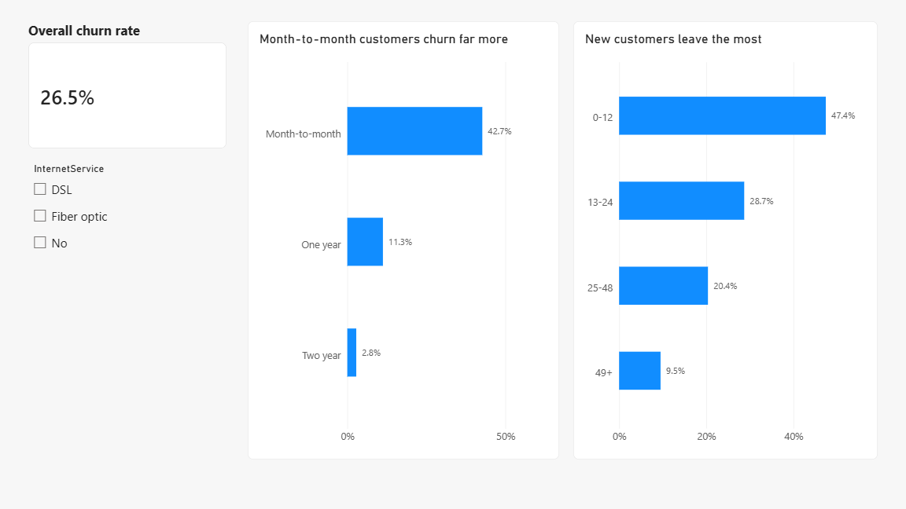
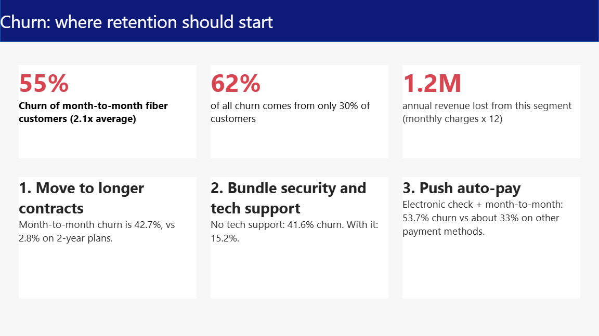
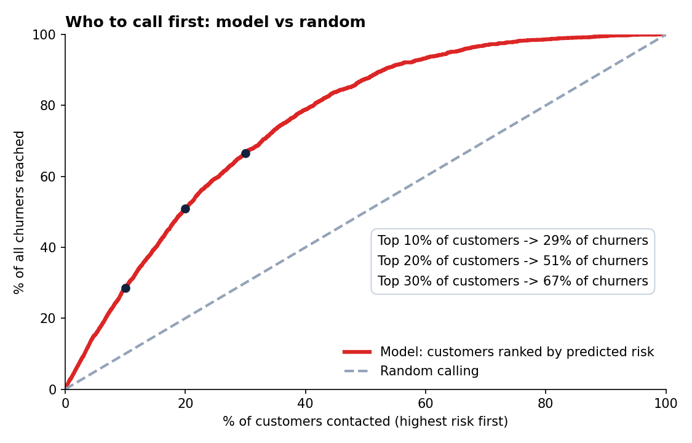

# Telco Customer Churn: Who Leaves and Where Retention Should Start

**Key insight:** Month-to-month fiber customers are about 30% of customers but 62% of all churn.

**At a glance:** 7,043 customers · 26.5% churn · Python (pandas, scipy, scikit-learn, statsmodels) + Power BI · cross-validated AUC 0.845 · the top 20% of customers by predicted risk contains 51% of all churners.

**Dashboard:** [ADD YOUR POWER BI PUBLISH-TO-WEB LINK HERE] · or open `dashboard/telco_churn.pbix` in Power BI Desktop (free).

[](images/dashboard_page1.png)
[](images/dashboard_page2.png)
[](images/dashboard_page3.png)

## Business question

About 1 in 4 customers leave. Which groups drive that churn, and what should retention do first?

## Findings

- Overall churn is 26.5% (7,043 customers).
- Month-to-month fiber customers (2,128 customers) churn at 55%, which is 2.1x the average, and account for 62% of all churn.
- Contract type is the strongest driver (Cramer's V 0.41), followed by tenure, online security, tech support and internet service. Gender is near zero (0.008).
- Churn by contract: month-to-month 42.7%, one year 11.3%, two year 2.8%.
- Churn by tenure: 0-12 months 47.4%, 13-24 months 28.7%, 25-48 months 20.4%, 49+ months 9.5%.
- Electronic check users churn at 45.3%, versus 15.2% to 19.1% for other payment methods. This gap is not just a contract effect (see below).
- Customers without tech support churn at 41.6%, versus 15.2% with it.
- Estimated annual revenue lost from the worst segment's churners: about 1.2M (monthly charges x 12; the dataset does not state a currency, so treat it as currency units).

## Statistical checks

**Is the worst segment really worse?** Month-to-month fiber customers churn at 54.6% (95% CI 52.5% to 56.7%, n=2,128), versus 14.4% for everyone else (95% CI 13.4% to 15.4%, n=4,915). The intervals do not overlap.

**Is it just a tenure effect?** No. Within every tenure band, month-to-month customers churn more than customers on longer contracts:

| Tenure band  | Longer contract | Month-to-month | Gap (points) |
|--------------|-----------------|----------------|--------------|
| 0-12 months  | 6.8%            | 51.4%          | 44.6         |
| 13-24 months | 5.6%            | 37.7%          | 32.1         |
| 25-48 months | 7.7%            | 32.9%          | 25.2         |
| 49+ months   | 6.5%            | 26.0%          | 19.5         |

**Is the electronic check gap just a contract effect?** Partly, but not entirely. 78% of electronic check users are on month-to-month contracts, versus 36% to 38% of auto-pay users, so contract mix explains some of the gap. But electronic check users still churn more within each contract group:

| Contract group | Electronic check | Bank transfer (auto) | Credit card (auto) | Mailed check |
|----------------|------------------|----------------------|--------------------|--------------|
| Month-to-month | 53.7% (n=1,850)  | 34.1% (n=589)        | 32.8% (n=543)      | 31.6% (n=893) |
| 1-2 year       | 15.0% (n=515)    | 6.0% (n=955)         | 5.5% (n=979)       | 3.6% (n=719) |

Holding contract, tenure, monthly charges and internet service constant, electronic check users have about 1.6x the odds of churning (odds ratio 1.63, 95% CI 1.43 to 1.86).

**Is the tech support gap just a fiber effect?** No. Fiber customers are more likely to lack tech support, but the gap holds within each internet service type:

| Internet service | Without tech support | With tech support | Gap (points) |
|------------------|----------------------|-------------------|--------------|
| DSL              | 27.8% (n=1,243)      | 9.7% (n=1,178)    | 18.1         |
| Fiber optic      | 49.4% (n=2,230)      | 22.6% (n=866)     | 26.8         |

Both payment method and tech support checks are reproduced by `python confounder_checks.py`.

**Limit:** these checks control for a few variables only. Price sensitivity, customer type and other factors could also matter, so every result here is an association, not proof of cause.

## Predictive model and targeting

- **Model:** logistic regression and gradient boosting, evaluated with 5-fold cross-validation (every prediction is on customers the model has not seen). Cross-validated AUC: 0.845 (logistic regression) and 0.834 (gradient boosting).
- **Adjusted contract effect:** holding all other columns constant, month-to-month customers have about 3.8x the odds of churning compared with two-year customers.
- **Who to call first:** ranking customers by predicted risk, the top 10% contains 29% of all churners (2.9x lift), the top 20% contains 51% (2.5x), and the top 30% contains 67% (2.2x).
- **Scenario (assumption, not a result):** the churners in the top 20% group represent about 924,550 in annual revenue. If a retention offer saved 10% / 20% / 30% of them, that is about 92,455 / 184,910 / 277,365 per year. The real save rate has to come from an A/B test.
- **Limit:** one snapshot of one company, with no external hold-out set, and the model is not deployed or tested on new data. The odds ratio is model-dependent and is still an association, not proof of cause.

[](images/gains_chart.png)

## Recommendations (in priority order)

| # | Action | Who | Evidence | Next step |
|---|--------|-----|----------|-----------|
| 1 | Offer incentives to move month-to-month customers onto 1-year plans | 2,128 month-to-month fiber customers | 54.6% churn vs 14.4% for everyone else; about 1.2M annual revenue lost | A/B test the offer on the top-20% risk list first |
| 2 | Bundle online security and tech support for new fiber customers | New customers in their first 12 months | 47.4% churn in months 0-12; 41.6% churn without tech support vs 15.2% with it; the gap holds within DSL and fiber | Pilot the bundle on the 0-12 month segment |
| 3 | Test auto-pay prompts for electronic check users | 1,850 month-to-month electronic check customers | 53.7% churn vs 31.6% to 34.1% for other payment methods in the same contract group (about 21 points) | A/B test an auto-pay prompt at billing |

The expected value of recommendation 1 is the scenario above: roughly 92K to 277K a year, depending on the real save rate.

## Method

- Python (pandas, scipy, matplotlib): cleaned the data (11 blank TotalCharges values set to 0; these are customers with 0 months of tenure), calculated churn by segment, ranked drivers by Cramer's V, and sized the worst segment's revenue at risk.
- Python (statsmodels): stratified and adjusted checks on the electronic check and tech support effects (`confounder_checks.py`).
- Python (scikit-learn): cross-validated logistic regression and gradient boosting to predict churn and rank customers by risk (`churn_model.py`).
- Power BI: 3-page dashboard (overview, drivers, actions).

## Data

Kaggle: [https://www.kaggle.com/datasets/blastchar/telco-customer-churn](https://www.kaggle.com/datasets/blastchar/telco-customer-churn) (IBM sample, 7,043 rows).

## How to reproduce

```bash
pip install -r requirements.txt
# download the CSV from Kaggle and save it as:
#   data/raw/WA_Fn-UseC_-Telco-Customer-Churn.csv
python churn_analysis.py          # findings, segments, Cramer's V, charts in images/charts/
python churn_model.py             # cross-validated models, images/gains_chart.png
python confounder_checks.py       # payment method and tech support checks
```

## Repo layout

```
.
├── README.md
├── requirements.txt
├── churn_analysis.py
├── churn_model.py
├── confounder_checks.py
├── dashboard/telco_churn.pbix
├── images/            dashboard screenshots and gains chart
└── data/raw/          raw CSV (not committed, see .gitignore)
```

## Limits

- These are associations, not proof of cause.
- One snapshot of one company; the dataset does not state a currency.
- Revenue at risk is an estimate (monthly charges x 12).
- The model has not been tested on data outside this dataset.

## Next step

Run an A/B test of the contract-upgrade offer (recommendation 1) before rolling it out. The save rate from that test replaces the 10% / 20% / 30% scenario above.
