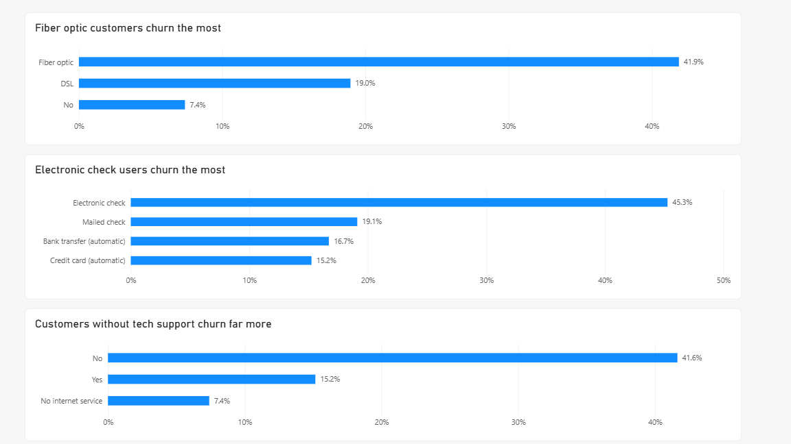
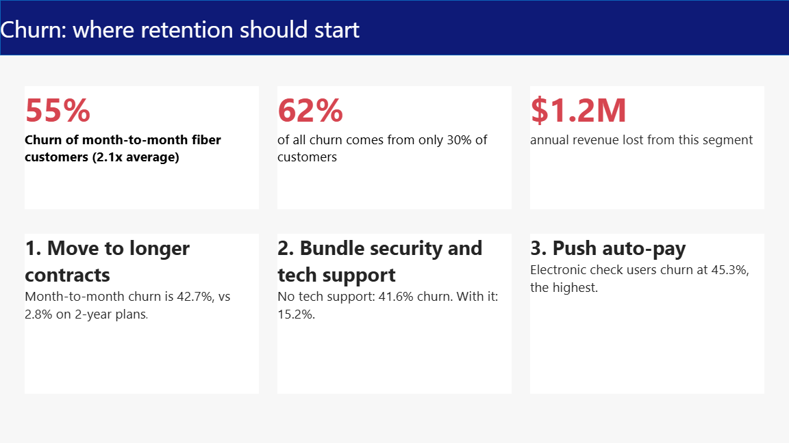

# Telco Customer Churn: Who Leaves and Where Retention Should Start

**Key insight:** Month-to-month fiber customers are about 30% of customers but 62% of all churn.

## Business question
About 1 in 4 customers leave. Which groups drive that churn, and what should retention do first?

## Findings
- Overall churn is 26.5% (7,043 customers).
- Month-to-month fiber customers (2,128 customers) churn at 55%, which is 2.1x the average, and account for 62% of all churn.
- Contract type is the strongest driver (Cramer's V 0.41), followed by tenure, online security, tech support and internet service. Gender is near zero (0.008).
- Churn by contract: month-to-month 42.7%, one year 11.3%, two year 2.8%.
- Churn by tenure: 0-12 months 47.4%, 13-24 months 28.7%, 25-48 months 20.4%, 49+ months 9.5%.
- Electronic check users churn at 45.3%, versus 15.2% to 19.1% for other payment methods.
- Customers without tech support churn at 41.6%, versus 15.2% with it.
- Estimated annual revenue lost from the worst segment's churners: about 1.2M (monthly charges x 12).

 ## Statistical checks
- **Is the worst segment really worse?** Month-to-month fiber customers churn at 54.6% (95% CI 52.5% to 56.7%, n=2,128), versus 14.4% for everyone else (95% CI 13.4% to 15.4%, n=4,915). The intervals do not overlap.
- **Is it just a tenure effect?** No. Within every tenure band, month-to-month customers churn more than customers on longer contracts:

| Tenure band | Longer contract | Month-to-month | Gap (points) |
|---|---|---|---|
| 0-12 months | 6.8% | 51.4% | 44.6 |
| 13-24 months | 5.6% | 37.7% | 32.1 |
| 25-48 months | 7.7% | 32.9% | 25.2 |
| 49+ months | 6.5% | 26.0% | 19.5 |

- **Limit:** this controls for tenure only. Price, service mix and customer type could also matter, so the result is still an association, not proof of cause.
  
## Predictive model and targeting
- **Model:** logistic regression and gradient boosting, evaluated with 5-fold cross-validation (every prediction is on customers the model has not seen). Cross-validated AUC: 0.845 (logistic regression) and 0.834 (gradient boosting).
- **Adjusted contract effect:** holding all other columns constant, month-to-month customers have about 3.8x the odds of churning compared with two-year customers.
- **Who to call first:** ranking customers by predicted risk, the top 10% contains 29% of all churners (2.9x lift), the top 20% contains 51% (2.5x), and the top 30% contains 67% (2.2x).
- **Scenario (assumption, not a result):** the churners in the top 20% group represent about 924,550 in annual revenue. If a retention offer saved 10% / 20% / 30% of them, that is about 92,455 / 184,910 / 277,365 per year. The real save rate has to come from an A/B test.
- **Limit:** one snapshot of one company, trained and tested on the same dataset, and not deployed. The odds ratio is model-dependent and is still an association, not proof of cause.

## Recommendations
1. Offer incentives to move month-to-month customers onto 1-year plans.
2. Bundle online security and tech support for new fiber customers.
3. Test auto-pay prompts for electronic check users.

## Method
- Python (pandas, scipy, matplotlib): cleaned the data (11 blank TotalCharges values set to 0), calculated churn by segment, ranked drivers by Cramer's V, and sized the worst segment's revenue at risk.
- Power BI: 3-page dashboard (overview, drivers, actions).

## Data
Kaggle: https://www.kaggle.com/datasets/blastchar/telco-customer-churn (IBM sample, 7,043 rows).

To reproduce: download the CSV from Kaggle, save it as `data/raw/WA_Fn-UseC_-Telco-Customer-Churn.csv`, then run `python churn_analysis.py`.

## Limits
- These are associations, not proof of cause.
- One snapshot of one company; the dataset does not state a currency.
- Revenue at risk is an estimate (monthly charges x 12).

## Next step
A/B test the contract-upgrade offer before rolling it out (Project 8).
